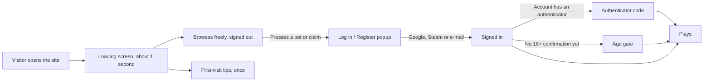

# App flow

The screens of Vaultrush, how people move between them, and the main journeys from start to finish. Last updated 2026-11-25. Routes are defined in `src/app.ts`.

## Navigation

- **Desktop:** a sidebar with every page (Play, Originals, Rewards, Fairness), a top bar with free coins, balance and item count, sound, chat and the account menu.
- **Phones (900 px and narrower):** a bottom bar with Home, Cases, Battles, Crash and More (the full list); chat opens as a side panel.
- **Footer:** company and legal pages, responsible play, and "Show the site tips".

## Routes

| Address | Screen |
|---|---|
| `#/` | Home: welcome, featured games, case grid, live drops |
| `#/cases` | Case list: search, price bands, tags, favourites, risk labels, quick open |
| `#/case/<id>` | One case: open 1 to 6, demo spin, contents with chances and ticket ranges |
| `#/battles` | Open battles to join or watch |
| `#/battles/create` | Create a battle: mode, players, cases, speed |
| `#/battle/<id>` | A battle: lobby, countdown, rounds, result |
| `#/upgrade` | Upgrade: stake items or coins, pick a target, chance, Auto |
| `#/crash`, `#/double`, `#/plinko`, `#/mines`, `#/coinflip` | The other games |
| `#/inventory` | Items held, sell one or all |
| `#/rewards`, `#/leaderboard` | Free crates, rakeback, calendar, promo codes; the daily race |
| `#/profile` | Player profile and statistics |
| `#/fair`, `#/rng` | Provably fair verifier; the RNG lab |
| `#/responsible` and the legal pages | Policy pages (`terms`, `privacy`, `cookies`, `refunds`, `aml`, `rules`, `ethics`, `disclaimer`, `about`, `contact`) |
| anything else | "Page not found" |

The **account window** (from the account menu) has its own tabs: Account, Security, Affiliates, Options, Game History, Transactions, Verification, Responsible Play, Cloud Account.

## First visit

An account with an authenticator app is asked for its 6-digit code after every sign-in (Google, Steam or e-mail) and when a saved session is restored; the window cannot be dismissed, only answered or left by signing out.

Signed-out visitors can look at everything, but any bet, claim, sale, creation or chat opens the log-in popup and nothing is saved for them.

## Main journeys

**Get coins:** claim free coins in the top bar (every 10 minutes), open the welcome and daily crates on Rewards, redeem a promo code, collect rakeback.

**Open a case:** Cases → pick a case (or the bolt on a card for quick open) → choose how many → Open → the reels land on the items the server drew → items appear in the inventory → sell them or use them in Upgrade.

**Battle:** Battles → Create (mode, format, cases, speed) or Join → empty seats wait for players or are filled by bots → countdown → one round per case, a short pause to read each pull → the winner takes the pot (or the pot is shared, by mode).

**Upgrade:** pick items and/or coins as the stake → pick a target (search, price slider, multiplier preset, or type a chance) → Upgrade, or Auto for up to 25 rounds with stop rules → a win gives the target item.

**Crash and Double:** one shared round for everyone → place a bet during the betting window → Crash: cash out before the crash (or set an auto cash-out); Double: the strip lands on a colour → paid at the end of the round.

**Stay in control:** Account → Responsible Play → limits, cool-off, self-exclusion; the reality check pops up on its own schedule.

**Check fairness:** Fairness → paste a server seed, client seed and nonce to recompute any result; rotate the seed to reveal the old one.

## Admin site (separate address)

Steam sign-in → authenticator code → admin password → panel: Overview, Site controls, Wallets, Staff and roles, Permissions, Audit log, Data explorer. Every change asks for a reason and is written to the audit log. Details: [admin-site.md](admin-site.md).
